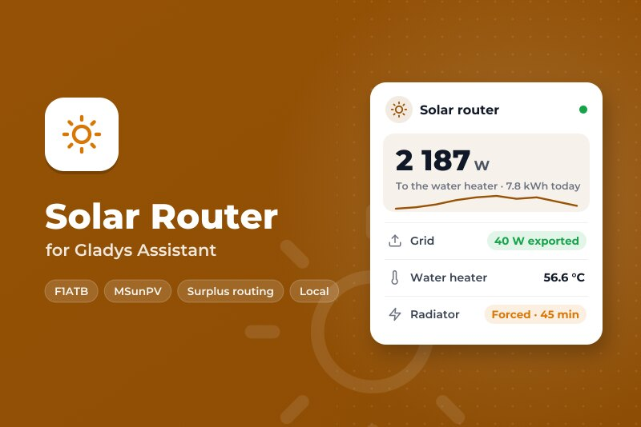
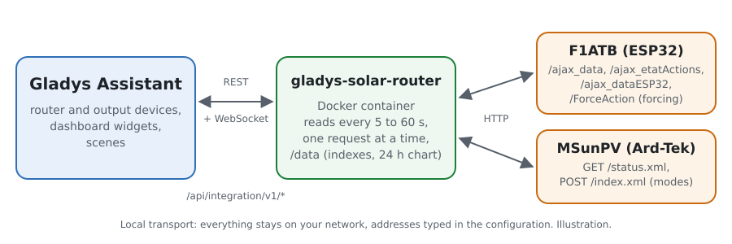
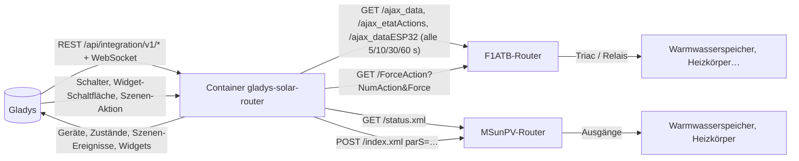
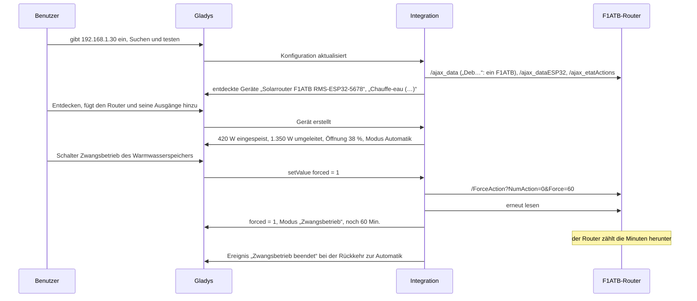
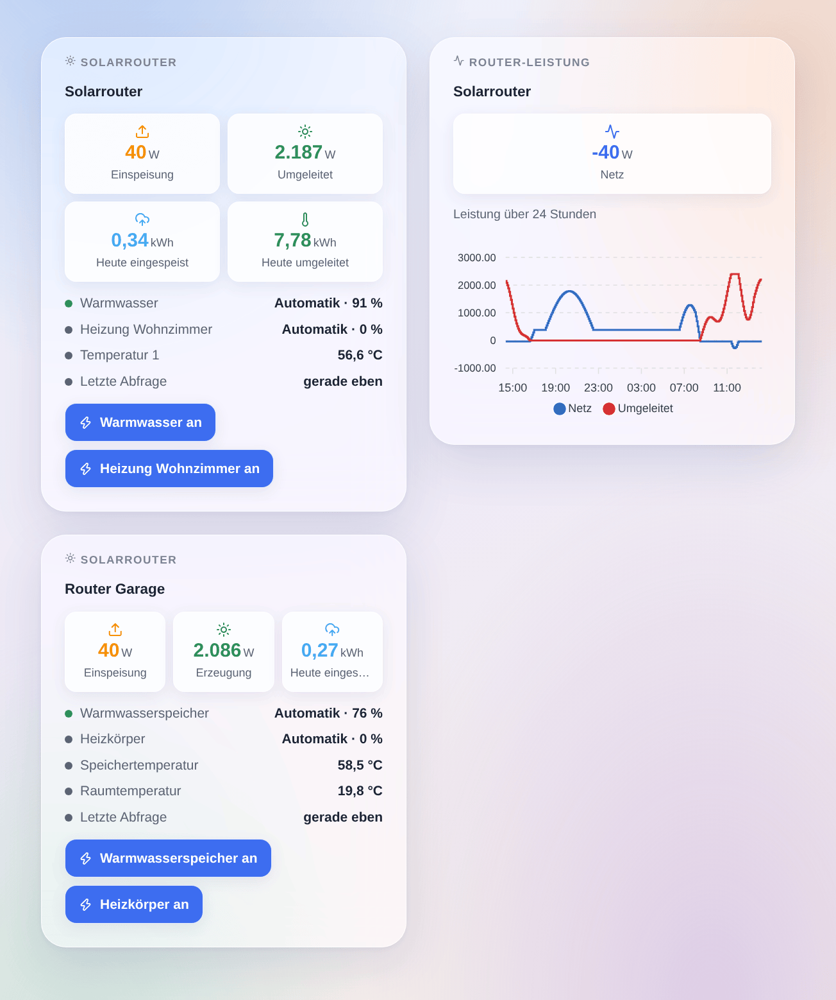

# Gladys Solarrouter

[English](README.md) · [Français](README.fr.md) · **Deutsch** · [Español](README.es.md)

[](LICENSE)
[](https://github.com/William-De71/gladys-solar-router/releases)
[](https://github.com/William-De71/gladys-solar-router/actions/workflows/release.yml)
[](https://gladysassistant.com)



Externe Integration für [Gladys Assistant](https://gladysassistant.com) für die Solarrouter **F1ATB** und **MSunPV**, die Kästchen, die den Überschuss deiner Solarmodule in den Warmwasserspeicher statt ins Netz leiten. Sie zeigt in Gladys den Netzaustausch, die umgeleitete oder erzeugte Leistung und den Zustand jedes Verbrauchers, lässt dich einen Verbraucher per Schalter, Widget oder Szene zwangsweise ein- oder ausschalten oder an die Automatik zurückgeben, und löst Szenen aus, wenn ein Router nicht mehr antwortet oder ein Zwangsbetrieb endet — nur in deinem lokalen Netzwerk.

Benutzerdokumentation: [English](docs/en.md) · [Français](docs/fr.md) · [Deutsch](docs/de.md) · [Español](docs/es.md).

Nicht mit F1ATB oder Ard-Tek verbunden. **Noch nicht mit einem echten Router getestet**: Die Anfragen und Antworten folgen den Quellen der F1ATB-Firmware (V17) und, für den MSunPV, den Feldern, die seine Home-Assistant-Integration dokumentiert (von keinem der beiden wurde Code übernommen).

## Funktionen

- Router **F1ATB** (ESP32, offene Firmware) und **MSunPV** (Ard-Tek, 2x2d und 4x4d): Adressen in der Konfiguration eingegeben, das Modell an seinen Antworten erkannt; ein Router wird über seine MAC-Adresse oder Seriennummer erkannt, eine neue IP-Adresse behält seine Geräte.
- **Ein Gerät für den Router**: Netzaustausch (Gladys-Kategorie `grid-sensor`), bezogene und eingespeiste Energie, umgeleitete Leistung und Energie (F1ATB mit zweiter Sonde), Solarerzeugung (MSunPV), Temperaturen, WLAN-Signal.
- **Ein Gerät pro Ausgang**: Öffnung oder Leistung, ein Schalter **Zwangsbetrieb** (F1ATB: für eine feste Dauer, vom Router heruntergezählt; MSunPV: bis zum Zurückschalten), der Modus, die Restzeit des Zwangsbetriebs.
- **4 Szenen-Auslöser** (antwortet nicht, antwortet wieder, neu gestartet, Zwangsbetrieb beendet), **2 Szenen-Aktionen** (Ausgang steuern, Energie heute) und **2 Dashboard-Widgets** (Übersicht mit Schaltflächen, Leistung über 24 Stunden).
- Router alle 5, 10, 30 oder 60 Sekunden abgefragt, eine Anfrage nach der anderen.
- Nur lokal, ohne Konto, ohne Cloud. Vier Sprachen überall: Englisch, Französisch, Deutsch, Spanisch.

## So funktioniert es





Von der Adresse zum Befehl:



### Transport

`transports: ["local"]`: Die Integration spricht per HTTP in deinem Netzwerk mit den Routern; **keine Daten verlassen dein Zuhause**. Mit nur einem Kanal gibt es weder die Schaltfläche „Lokale Verbindung bevorzugen“ noch ein Transport-Abzeichen pro Gerät. Keiner der beiden Router meldet sich im Netzwerk an (kein mDNS): Die Adressen werden eingegeben. `/data/solar-router.json` (Modus 0600) speichert pro Router seine letzte Adresse und sein Modell, seine Werte und Ausgänge, die zu Zählern aufsummierten MSunPV-Tageszähler, 24 Stunden 5-Minuten-Punkte für das Diagramm und das, was die Auslöser wissen.

## Geräte und Funktionen

| Gerät         | Funktionen (Kategorie / Typ)                                                                                                                                                                                                                                                                                                             |
| ------------- | ---------------------------------------------------------------------------------------------------------------------------------------------------------------------------------------------------------------------------------------------------------------------------------------------------------------------------------------- |
| F1ATB-Router  | Bezug und Einspeisung (`grid-sensor` / `input-power`, `output-power`, W), bezogene und eingespeiste Energie (`grid-sensor` / `input-index`, `output-index`, kWh), umgeleitete Leistung und Energie (`energy-sensor` / `power`, `index`), Temperaturen 1 bis 4 (`temperature-sensor` / `decimal`, °C), WLAN-Signal (`signal` / `integer`) |
| MSunPV-Router | Netzaustausch (`grid-sensor` / `power`, W, mit Vorzeichen), bezogene und eingespeiste Energie (`grid-sensor` / `input-index`, `output-index`, aus den Tageszählern aufsummiert), Erzeugung (`energy-production-sensor` / `power`, `index`), Speicher-, Bad- und Raumtemperatur, WLAN-Signal                                              |
| Ausgang       | Öffnung (`switch` / `dimmer`, 0–100, nur lesbar) oder Leistung und Energie (MSunPV 4x4d, `energy-sensor`), Zwangsbetrieb (`switch` / `binary`, der einzige Befehl), Modus (`text` / `text`), Restzeit Zwangsbetrieb (`duration` / `integer`, Min., F1ATB), Volllaststunden heute (`duration` / `decimal`, h, F1ATB)                      |

- Die externen IDs beruhen auf der Identität des Routers: `ext:…:router:<id>` (die 12 Hexadezimalziffern der MAC-Adresse des F1ATB oder die Seriennummer des MSunPV), `ext:…:output:<id>-a<n>` für die Aktion n eines F1ATB (0 ist der Triac), `ext:…:output:<id>-water_heater` und `-heater` für einen MSunPV.
- Das Netz folgt der Gladys-Kategorie `grid-sensor` so, wie jeder Router es meldet: zwei Werte beim F1ATB, ein Wert mit Vorzeichen beim MSunPV (Bezug > 0, Einspeisung < 0).
- Der MSunPV liefert nur Tageszähler: Die Integration summiert sie zu Zählerständen auf, die bei der ersten Abfrage bei 0 beginnen; Gladys verwendet nur ihre Zuwächse.
- Eine Funktion erscheint, sobald ihr Wert gesehen wurde (zweite Sonde, Temperatursonde, WLAN statt Ethernet): Drücke **Aktualisieren** im Bildschirm Entdecken.
- Die Zustände werden bei jeder Änderung gesendet, sonst alle 30 Minuten; ein nicht erreichbarer Router sendet nichts (Gladys zeigt seine Werte als veraltet).

## Szenen-Auslöser, Aktionen und Widgets



**Widgets**: Solarrouter (ein Router, standardmäßig der erste: aktueller Bezug oder Einspeisung, umgeleitete oder erzeugte Leistung, heute eingespeiste und umgeleitete Energie, Zustand jedes Ausgangs, zwei Temperaturen, letzte Abfrage und eine Schaltfläche „… an“ / „… Auto“ für jeden der ersten zwei Ausgänge) und Router-Leistung (Netzaustausch und umgeleitete oder erzeugte Leistung der letzten 24 Stunden, ein Punkt alle 5 Minuten).

**Auslöser** (ein Ereignis pro Wechsel, nie bei der ersten Abfrage, nie als Folge einer Aktion; Filter: der Router oder der Ausgang):

- **antwortet nicht**: keine Antwort auf 3 Abfragen in Folge und mindestens eine Minute lang; Variablen: Router, Name, Modell, Adresse, fehlgeschlagene Abfragen, Nachricht;
- **antwortet wieder**: Variable: Minuten ohne Antwort;
- **neu gestartet** (F1ATB): die Laufzeit begann von vorn; Variable: Laufzeit davor in Stunden;
- **Zwangsbetrieb beendet** (F1ATB): ein erzwungener Ausgang ist von selbst zur Automatik zurückgekehrt; Variablen: Ausgang, Name des Ausgangs, beendeter Zwangsbetrieb (`on` / `off`).

**Aktionen**:

- **Ausgang steuern**: Zwangsbetrieb, Aus (Zwangsabschaltung beim F1ATB) oder Automatik, mit einer Dauer in Minuten für einen F1ATB; Ausgaben: Name des Ausgangs, Modus, Minuten, `summary`;
- **Energie heute**: heute bezogen, eingespeist, umgeleitet und erzeugt, so wie der Router zählt, der aktuelle Netzaustausch (W, Einspeisung < 0) und eine `summary`.

Die Werte sind Gerätefunktionen: „Einspeisung über 1.000 W“ oder „Speicher unter 45 °C“ sind Gerätebedingungen von Gladys, mit deinen eigenen Schwellen.

Absichtlich nicht umgesetzt: keine Änderung der Router-Einstellungen (Schwellen, PID, Prioritäten), kein MQTT, kein Import des Verlaufs.

Beispiele:

- Jede Nacht um 23 Uhr, wenn die **Speichertemperatur** unter 45 °C liegt → **Ausgang steuern** (Warmwasserspeicher, Zwangsbetrieb, 120 Minuten).
- Wenn **Zwangsbetrieb beendet** → „{{triggerEvent.data.output_name}}: zurück auf Automatik“ senden.
- Jeden Abend um 21 Uhr → **Energie heute** → seine `summary` senden.

## Voraussetzungen

- Gladys Assistant **5.3.0** oder neuer (Widgets und Szenen der Integrationen, Kategorie `grid-sensor`, Katalog-Schlüsselwörter): Ältere Instanzen können die Integration nicht installieren.
- Ein **F1ATB**-Router (Firmware V17 oder ähnlich) oder **MSunPV**, über seine eigene Weboberfläche eingerichtet, im selben Netzwerk wie Gladys.
- Seine IP-Adresse (auf dem Display des Routers oder in deinem Internet-Router), am besten per DHCP-Reservierung fest.

### Das Tempo des Geräts

Beide Router sind kleine Platinen, die auch ihre eigene Webseite ausliefern und die Leistung mehrmals pro Sekunde regeln: Der Client sendet eine Anfrage nach der anderen, ohne Keep-alive, mit 10 Sekunden Zeitlimit und einer kurzen Pause zwischen zwei Anfragen. Eine F1ATB-Runde sind drei Anfragen, eine MSunPV-Runde eine. Ein Befehl liest den Router sofort erneut. Eine Adresse, die kein Router ist, bleibt 30 Minuten unbeachtet (oder bis **Suchen und testen**).

## Installation

- **Aus dem Store**: Integrationen → Solar Router (F1ATB, MSunPV) → Installieren.
- **Über die URL des Repositorys**: Integrationen → externe Integration → `https://github.com/William-De71/gladys-solar-router`.
- **Entwicklermodus**: Starte `npm start` mit den Variablen, die Gladys dir gibt (siehe Entwicklung).

## Konfiguration

| Feld oder Schaltfläche           | Standard    | Bedeutung                                                                                                     |
| -------------------------------- | ----------- | ------------------------------------------------------------------------------------------------------------- |
| Router-Adressen                  | —           | IP-Adressen oder Namen, durch Kommas getrennt, mit `:port`, wenn es nicht 80 ist; Pflichtfeld                 |
| Abfrage                          | 10 s        | 5 s, 10 s, 30 s oder 1 Min.                                                                                   |
| Dauer des Zwangsbetriebs (F1ATB) | 60 Min.     | Wie lange der Schalter Zwangsbetrieb und die Widget-Schaltflächen einen F1ATB-Ausgang erzwingen               |
| Sprache der Texte                | automatisch | Namen der Funktionen, Modi, Szenentexte und Fehler (automatisch: Sprache des zuletzt angezeigten Widgets)     |
| Suchen und testen / Diagnose     | —           | Liest die Router und bietet ihre Geräte an, nennt die fehlerhafte Adresse; schreibt den Zustand ins Protokoll |

## Verwendung

1. Richte den Router über seine eigene Weboberfläche ein (Ausgänge, Sonden) und notiere seine IP-Adresse.
2. In Gladys (Integrationen → Solar Router → Konfiguration): Gib die Adresse ein; drücke **Suchen und testen**.
3. **Entdecken**, dann den Router und die gewünschten Ausgänge als Geräte hinzufügen.
4. Füge die Widgets einem Dashboard hinzu, erstelle Szenen mit den Funktionen, Auslösern und Aktionen.

## Entwicklung

```bash
npm install
npm test                       # node --test, gefälschte F1ATB- und MSunPV-Router, nie das Netzwerk
npm run lint                   # ESLint
npm run format:check           # Prettier
npx github:GladysAssistant/integration-store . --skip-image-check
scripts/build-cover.sh         # cover.jpg aus docs/assets/cover.svg
docs/illustrations/render.sh   # docs/assets/widgets.<lang>.png
```

Lokal liest das SDK `GLADYS_HOST_API_URL`, `GLADYS_INTEGRATION_TOKEN` und `GLADYS_INTEGRATION_SELECTOR` (von Gladys im Entwicklermodus geliefert), und die Integration liest `TZ`. `DEBUG=gladys-integration-sdk` zeigt die Protokolle des SDK.

Die Tests decken den HTTP-Client ab (eine Anfrage nach der anderen, die Fehler), beide Protokolle (die Seiten mit Steuerzeichen des F1ATB, status.xml und die Befehlsbits des MSunPV), die Momentaufnahmen und aufsummierten Zählerstände, die Geräte (die vom Bildschirm Entdecken verlangten Felder, die Kategorie-/Typ-Paare des Kerns), die Auslöser, die Widgets (`validateWidgetContent`), das Manifest, die vier Sprachen, das Release-Skript und die ganze Integration gegen das gefälschte Gladys des SDK und gefälschte Router. `test/structure.test.js` friert jeden bei den Benutzern gespeicherten Schlüssel ein.

## Release-Prozess


Jeder Merge auf `main` startet die CI und berechnet dann die Version aus den [Conventional Commits](https://www.conventionalcommits.org/) seit dem letzten Tag: `feat` → Minor, `fix` / `perf` → Patch, `!` oder `BREAKING CHANGE` → Major (ein Minor vor 1.0.0); `docs`, `chore`, `ci`, `test`, `style`, `refactor`, `build` allein veröffentlichen nichts. Der Changelog-Abschnitt wird erzeugt, der Tag gepusht, das Multi-Architektur-Image gebaut, dann erhält `main` den Release-Commit, das GitHub Release wird erstellt und ein letzter Job prüft das öffentliche Image, den Store-Validator und das Topic.

- Der Titel des Pull Requests wird zum Squash-Commit, dann zur Changelog-Zeile: Schreibe ihn auf Englisch, für den Benutzer (`pr-title.yml` prüft ihn). Bearbeite `CHANGELOG.md` nie von Hand.
- 1.0.0 ist eine Entscheidung: Actions → Release → Run workflow mit `release-as: 1.0.0`. `dry-run` zeigt die Version und die Notizen, ohne zu veröffentlichen.
- **Geschützter Branch**: Das Release pusht seinen Commit mit `GITHUB_TOKEN` auf `main`. Das Ruleset `protect-main` (kein Löschen, kein Force-Push) lässt ihn durch; eine strengere Regel (Pull Request erforderlich, Status-Checks) bräuchte GitHub Actions in der Bypass-Liste oder eine GitHub App.
- Mache nach dem ersten Release das Paket auf `ghcr.io` öffentlich (Package settings → Change visibility), sonst kann Gladys es nicht herunterladen.

## Fehlerbehebung

Siehe [docs/de.md](docs/de.md#fehlerbehebung). Melde Probleme mit den Versionen von Gladys, der Integration und der Router-Firmware, dem Modell des Routers, der Meldung von **Suchen und testen** und dem Ergebnis der **Diagnose** (in den Protokollen der Integration).

## Mitwirken

Issues und Pull Requests sind willkommen. Führe `npm run format:check && npm run lint && npm test` aus, bevor du einen Pull Request öffnest, und lass alle externen IDs und gespeicherten Schlüssel unverändert (siehe [CLAUDE.md](CLAUDE.md)). Antworten eines echten Routers (mit geänderter MAC-Adresse oder Seriennummer) sind als Testdaten besonders willkommen.

## Sicherheit

Siehe [SECURITY.md](SECURITY.md): Melde Schwachstellen vertraulich. Die Router haben auf den verwendeten Seiten kein Passwort; jeder in deinem Netzwerk kann sie bereits erreichen, halte sie also in einem vertrauenswürdigen Netzwerk. `/data/solar-router.json` wird mit Modus 0600 geschrieben.

## Kommende Screenshots

Die Bilder oben sind Illustrationen, keine Screenshots. Echte Screenshots kommen nach `docs/assets/screenshots/` (PNG, 1280 × 800): `configuration.png`, `discovery.png` (ein Router und seine Ausgänge angeboten), `device.png` (ein Ausgang mit seinem Schalter Zwangsbetrieb), `scene-forcing.png` (eine Szene mit der Aktion „Ausgang steuern“), `dashboard.png` (die zwei Widgets mit einem echten Router).

## Lizenz

[Apache License 2.0](LICENSE) — siehe auch [NOTICE](NOTICE). F1ATB, MSunPV und Ard-Tek sind Namen ihrer Inhaber. Danke an die Dokumentation und das SDK von Gladys, an F1ATB für die veröffentlichten Quellen des Routers und an die Home-Assistant-Integration MSunPV für die Dokumentation von status.xml (nur für die Fakten gelesen, kein Code übernommen).
