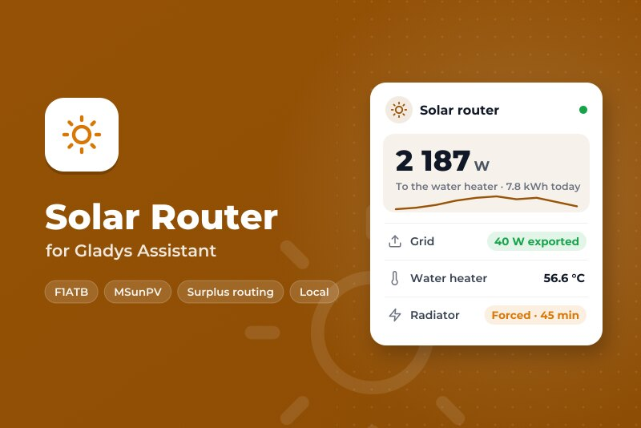
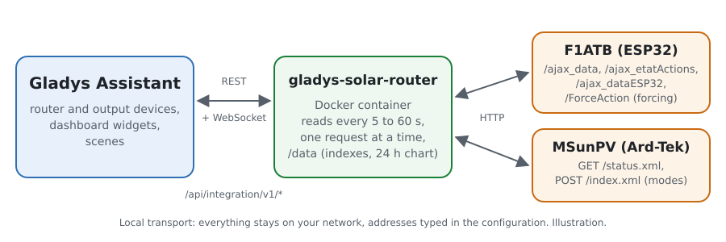
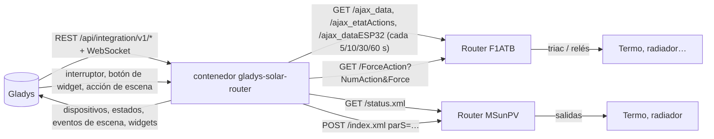
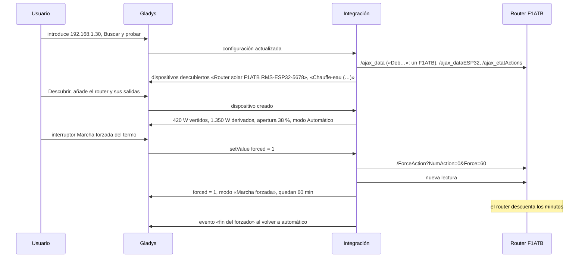
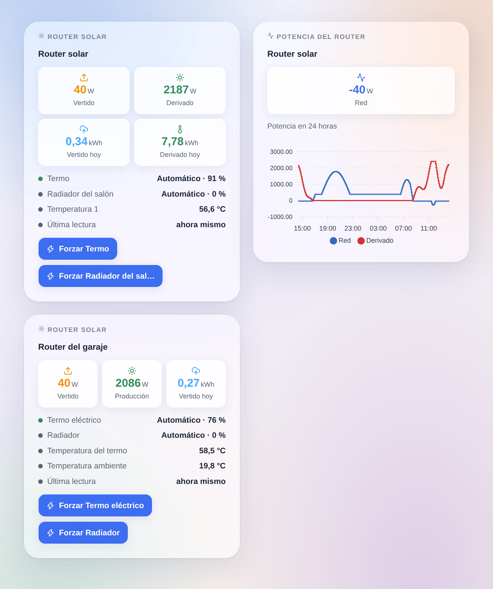

# Gladys Router solar

[English](README.md) · [Français](README.fr.md) · [Deutsch](README.de.md) · **Español**

[](LICENSE)
[](https://github.com/William-De71/gladys-solar-router/releases)
[](https://github.com/William-De71/gladys-solar-router/actions/workflows/release.yml)
[](https://gladysassistant.com)



Integración externa de [Gladys Assistant](https://gladysassistant.com) para los routers solares **F1ATB** y **MSunPV**, los aparatos que envían el excedente de sus paneles al termo en lugar de a la red. Muestra en Gladys el intercambio con la red, la potencia derivada o producida y el estado de cada carga, permite forzar una carga en marcha, en parada o devolverla a automático desde un interruptor, un widget o una escena, y dispara escenas cuando un router deja de responder o termina un forzado — solo en su red local.

Documentación de usuario: [English](docs/en.md) · [Français](docs/fr.md) · [Deutsch](docs/de.md) · [Español](docs/es.md).

No afiliada a F1ATB ni a Ard-Tek. **Todavía no probada con un router real**: las peticiones y respuestas siguen las fuentes del firmware F1ATB (V17) y, para el MSunPV, los campos documentados por su integración de Home Assistant (no se ha tomado código de ninguno de los dos).

## Funciones

- Routers **F1ATB** (ESP32, firmware abierto) y **MSunPV** (Ard-Tek, 2x2d y 4x4d): direcciones introducidas en la configuración, modelo reconocido por sus respuestas; un router se conoce por su dirección MAC o su número de serie, una nueva dirección IP conserva sus dispositivos.
- **Un dispositivo para el router**: intercambio con la red (categoría `grid-sensor` de Gladys), energía consumida y vertida, potencia y energía derivadas (F1ATB con una segunda sonda), producción solar (MSunPV), temperaturas, señal Wi-Fi.
- **Un dispositivo por salida**: apertura o potencia, un interruptor **Marcha forzada** (F1ATB: durante un tiempo fijado, descontado por el router; MSunPV: hasta volver a automático), el modo, el tiempo de forzado restante.
- **4 disparadores de escena** (no responde, vuelve a responder, reiniciado, fin del forzado), **2 acciones de escena** (controlar una salida, energía del día) y **2 widgets** (resumen con botones, potencia en 24 horas).
- Routers leídos cada 5, 10, 30 o 60 segundos, una petición a la vez.
- Solo local, sin cuenta ni nube. Cuatro idiomas en todas partes: inglés, francés, alemán, español.

## Cómo funciona





De la dirección a una orden:



### Transporte

`transports: ["local"]`: la integración se comunica con los routers por HTTP en su red; **ningún dato sale de su casa**. Con un solo canal, no hay botón «Preferir la conexión local» ni distintivo de transporte por dispositivo. Ninguno de los dos routers se anuncia en la red (sin mDNS): las direcciones se introducen. `/data/solar-router.json` (modo 0600) guarda, por router, su última dirección y su modelo, sus valores y salidas, los contadores del MSunPV sumados en índices, 24 horas de puntos cada 5 minutos para el gráfico, y lo que saben los disparadores.

## Dispositivos y funciones

| Dispositivo   | Funciones (categoría / tipo)                                                                                                                                                                                                                                                                                                    |
| ------------- | ------------------------------------------------------------------------------------------------------------------------------------------------------------------------------------------------------------------------------------------------------------------------------------------------------------------------------- |
| Router F1ATB  | Consumo de red y vertido (`grid-sensor` / `input-power`, `output-power`, W), energía consumida y vertida (`grid-sensor` / `input-index`, `output-index`, kWh), potencia y energía derivadas (`energy-sensor` / `power`, `index`), temperaturas 1 a 4 (`temperature-sensor` / `decimal`, °C), señal Wi-Fi (`signal` / `integer`) |
| Router MSunPV | Intercambio con la red (`grid-sensor` / `power`, W, con signo), energía consumida y vertida (`grid-sensor` / `input-index`, `output-index`, sumadas desde los contadores diarios), producción (`energy-production-sensor` / `power`, `index`), temperaturas del termo, del baño y ambiente, señal Wi-Fi                         |
| Salida        | Apertura (`switch` / `dimmer`, 0–100, solo lectura) o potencia y energía (MSunPV 4x4d, `energy-sensor`), Marcha forzada (`switch` / `binary`, la única orden), modo (`text` / `text`), tiempo de forzado restante (`duration` / `integer`, min, F1ATB), horas a plena potencia hoy (`duration` / `decimal`, h, F1ATB)           |

- Los identificadores externos se basan en la identidad del router: `ext:…:router:<id>` (los 12 dígitos hexadecimales de la dirección MAC del F1ATB, o el número de serie del MSunPV), `ext:…:output:<id>-a<n>` para la acción n de un F1ATB (0 es el triac), `ext:…:output:<id>-water_heater` y `-heater` para un MSunPV.
- La red sigue la categoría `grid-sensor` de Gladys tal como la da cada router: dos valores para el F1ATB, un valor con signo para el MSunPV (consumo > 0, vertido < 0).
- El MSunPV solo da contadores diarios: la integración los suma en índices, que empiezan en 0 en la primera lectura; Gladys solo usa sus aumentos.
- Una función aparece en cuanto se ha visto su valor (segunda sonda, sonda de temperatura, Wi-Fi en lugar de Ethernet): pulse **Actualizar** en la pantalla Descubrir.
- Los estados se envían cuando cambian y, si no, cada 30 minutos; un router inaccesible no envía nada (Gladys muestra sus valores como antiguos).

## Disparadores, acciones de escena y widgets



**Widgets**: Router solar (un router, el primero por defecto: potencia consumida o vertida ahora, potencia derivada o producida, energía vertida y derivada hoy, estado de cada salida, dos temperaturas, última lectura y un botón «Forzar …» / «Auto …» para cada una de las dos primeras salidas) y Potencia del router (el intercambio con la red y la potencia derivada o producida en las últimas 24 horas, un punto cada 5 minutos).

**Disparadores** (un evento por cambio, nunca en la primera lectura, nunca como resultado de una acción; filtro: el router o la salida):

- **no responde**: sin respuesta a 3 lecturas seguidas durante al menos un minuto; variables: router, nombre, modelo, dirección, lecturas fallidas, mensaje;
- **vuelve a responder**: variable: minutos sin respuesta;
- **reiniciado** (F1ATB): el tiempo de funcionamiento volvió a cero; variable: horas de funcionamiento antes;
- **fin del forzado** (F1ATB): una salida forzada en marcha o parada ha vuelto sola a automático; variables: salida, nombre de la salida, forzado terminado (`on` / `off`).

**Acciones**:

- **controlar una salida**: marcha forzada, parada (parada forzada en un F1ATB) o automático, con una duración en minutos para un F1ATB; resultados: nombre de la salida, modo, minutos, `summary`;
- **energía del día**: consumida, vertida, derivada y producida hoy tal como la cuenta el router, el intercambio actual con la red (W, vertido < 0) y un `summary`.

Los valores son funciones de dispositivo: «vertido superior a 1.000 W» o «termo por debajo de 45 °C» son condiciones de dispositivo de Gladys, con sus propios umbrales.

No hecho, a propósito: ningún cambio de los ajustes del router (umbrales, PID, prioridades), sin MQTT, sin importación del historial.

Ejemplos:

- Cada noche a las 23:00, si la **Temperatura del termo** está por debajo de 45 °C → **controlar una salida** (termo, marcha forzada, 120 minutos).
- Cuando **fin del forzado** → enviar «{{triggerEvent.data.output_name}}: vuelta a automático».
- Cada tarde a las 21:00 → **energía del día** → enviar su `summary`.

## Requisitos

- Gladys Assistant **5.3.0** o posterior (widgets y escenas de las integraciones, categoría `grid-sensor`, palabras clave del catálogo): las instancias más antiguas no pueden instalar la integración.
- Un router **F1ATB** (firmware V17 o cercano) o **MSunPV** configurado con su propia interfaz web, en la misma red que Gladys.
- Su dirección IP (en la pantalla del router o en su router de internet), idealmente fija con una reserva DHCP.

### El ritmo del aparato

Los dos routers son pequeñas placas que también sirven su propia página web y regulan la potencia varias veces por segundo: el cliente envía una petición a la vez, sin keep-alive, con un tiempo de espera de 10 segundos y una breve pausa entre dos peticiones. Una ronda F1ATB son tres peticiones, una ronda MSunPV una sola. Una orden vuelve a leer el router enseguida. Una dirección que no es un router se deja de lado 30 minutos (o hasta **Buscar y probar**).

## Instalación

- **Desde la tienda**: Integraciones → Solar Router (F1ATB, MSunPV) → Instalar.
- **Desde la URL del repositorio**: Integraciones → integración externa → `https://github.com/William-De71/gladys-solar-router`.
- **Modo desarrollador**: ejecute `npm start` con las variables que da Gladys (vea Desarrollo).

## Configuración

| Campo o botón                 | Por defecto | Significado                                                                                                  |
| ----------------------------- | ----------- | ------------------------------------------------------------------------------------------------------------ |
| Direcciones de los routers    | —           | Direcciones IP o nombres, separados por comas, con `:puerto` si no es el 80; obligatorio                     |
| Lectura                       | 10 s        | 5 s, 10 s, 30 s o 1 min                                                                                      |
| Duración del forzado (F1ATB)  | 60 min      | Cuánto tiempo el interruptor Marcha forzada y los botones del widget fuerzan una salida F1ATB                |
| Idioma de los textos          | automático  | Nombres de las funciones, modos, textos de escenas y errores (automático: idioma del último widget)          |
| Buscar y probar / Diagnóstico | —           | Lee los routers y ofrece sus dispositivos, indica la dirección que falla; escribe el estado en los registros |

## Uso

1. Configure el router con su propia interfaz web (salidas, sondas) y anote su dirección IP.
2. En Gladys (Integraciones → Solar Router → Configuración): introduzca la dirección; pulse **Buscar y probar**.
3. **Descubrir**, luego añada el router y las salidas deseadas como dispositivos.
4. Añada los widgets a un panel, cree escenas con las funciones, los disparadores y las acciones.

## Desarrollo

```bash
npm install
npm test                       # node --test, routers F1ATB y MSunPV falsos, nunca la red
npm run lint                   # ESLint
npm run format:check           # Prettier
npx github:GladysAssistant/integration-store . --skip-image-check
scripts/build-cover.sh         # cover.jpg desde docs/assets/cover.svg
docs/illustrations/render.sh   # docs/assets/widgets.<lang>.png
```

En local, el SDK lee `GLADYS_HOST_API_URL`, `GLADYS_INTEGRATION_TOKEN` y `GLADYS_INTEGRATION_SELECTOR` (dados por Gladys en modo desarrollador), y la integración lee `TZ`. `DEBUG=gladys-integration-sdk` muestra los registros del SDK.

Las pruebas cubren el cliente HTTP (una petición a la vez, los errores), los dos protocolos (las páginas con caracteres de control del F1ATB, status.xml y los bits de orden del MSunPV), las instantáneas y los índices sumados, los dispositivos (los campos que exige la pantalla Descubrir, los pares categoría / tipo del núcleo), los disparadores, los widgets (`validateWidgetContent`), el manifiesto, los cuatro idiomas, el script de release y toda la integración frente al Gladys falso del SDK y routers falsos. `test/structure.test.js` congela cada clave guardada por los usuarios.

## Proceso de release


Cada fusión en `main` ejecuta la CI y luego calcula la versión a partir de los [Conventional Commits](https://www.conventionalcommits.org/) desde la última etiqueta: `feat` → menor, `fix` / `perf` → parche, `!` o `BREAKING CHANGE` → mayor (una menor antes de 1.0.0); `docs`, `chore`, `ci`, `test`, `style`, `refactor`, `build` solos no publican nada. Se genera la sección del changelog, se publica la etiqueta, se construye la imagen multiarquitectura, luego `main` recibe el commit de release, se crea la GitHub Release y un último job comprueba la imagen pública, el validador de la tienda y el topic.

- El título de la pull request se convierte en el commit squash y luego en la línea del changelog: escríbalo en inglés, para el usuario (`pr-title.yml` lo comprueba). No edite nunca `CHANGELOG.md` a mano.
- 1.0.0 es una decisión: Actions → Release → Run workflow con `release-as: 1.0.0`. `dry-run` muestra la versión y las notas sin publicar.
- **Rama protegida**: la release empuja su commit a `main` con `GITHUB_TOKEN`. El ruleset `protect-main` (sin borrado, sin force-push) lo deja pasar; una regla más estricta (pull request obligatoria, status checks) necesitaría GitHub Actions en su lista de excepciones, o una GitHub App.
- Tras la primera release, haga público el paquete `ghcr.io` (Package settings → Change visibility), o Gladys no podrá descargarlo.

## Solución de problemas

Vea [docs/es.md](docs/es.md#solución-de-problemas). Informe de los problemas con las versiones de Gladys, de la integración y del firmware del router, el modelo del router, el mensaje de **Buscar y probar** y el resultado de **Diagnóstico** (en los registros de la integración).

## Contribuir

Issues y pull requests son bienvenidas. Ejecute `npm run format:check && npm run lint && npm test` antes de abrir una pull request, y mantenga sin cambios todos los identificadores externos y claves guardadas (vea [CLAUDE.md](CLAUDE.md)). Las respuestas capturadas de un router real (con la dirección MAC o el número de serie cambiados) son especialmente bienvenidas como datos de prueba.

## Seguridad

Vea [SECURITY.md](SECURITY.md): informe de las vulnerabilidades en privado. Los routers no tienen contraseña en las páginas usadas; cualquiera en su red ya puede acceder a ellos, así que manténgalos en una red de confianza. `/data/solar-router.json` se escribe con el modo 0600.

## Capturas por venir

Las imágenes de arriba son ilustraciones, no capturas de pantalla. Las capturas reales irán en `docs/assets/screenshots/` (PNG, 1280 × 800): `configuration.png`, `discovery.png` (un router y sus salidas ofrecidos), `device.png` (una salida con su interruptor Marcha forzada), `scene-forcing.png` (una escena con la acción «controlar una salida»), `dashboard.png` (los dos widgets con un router real).

## Licencia

[Apache License 2.0](LICENSE) — vea también [NOTICE](NOTICE). F1ATB, MSunPV y Ard-Tek son nombres de sus propietarios. Gracias a la documentación y al SDK de Gladys, a F1ATB por las fuentes publicadas del router, y a la integración MSunPV de Home Assistant por documentar status.xml (leídas solo por los hechos, sin tomar código).
