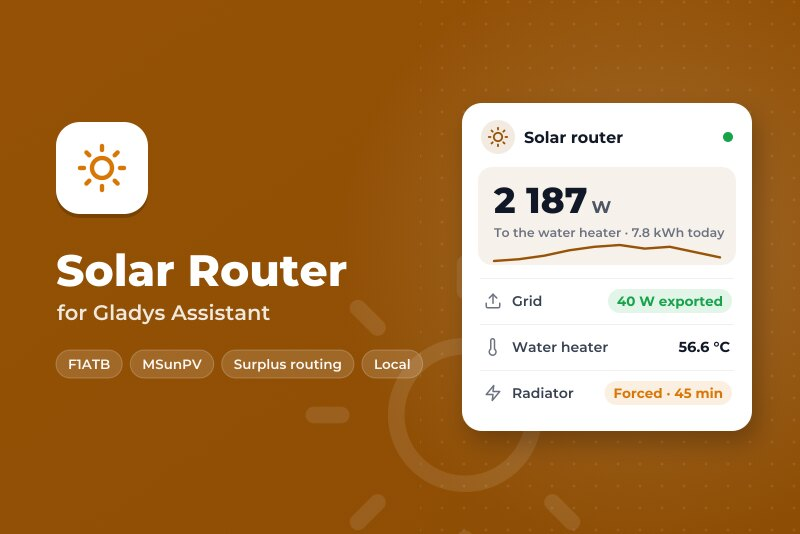
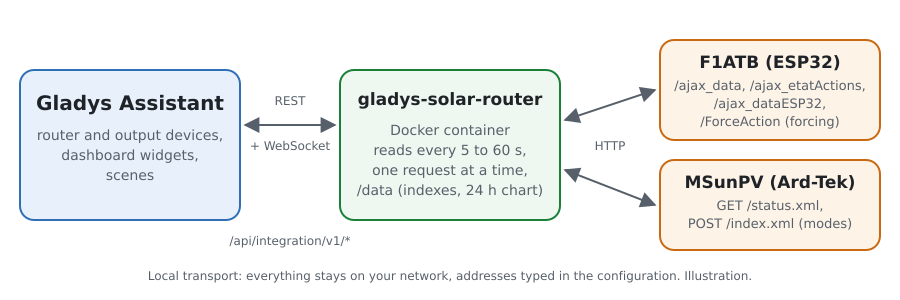
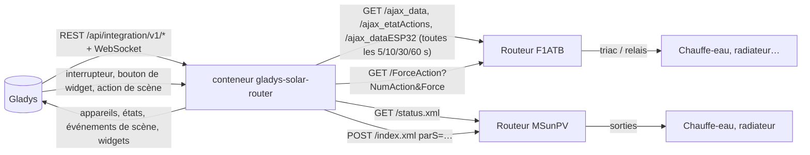
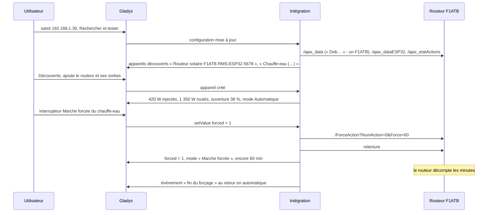
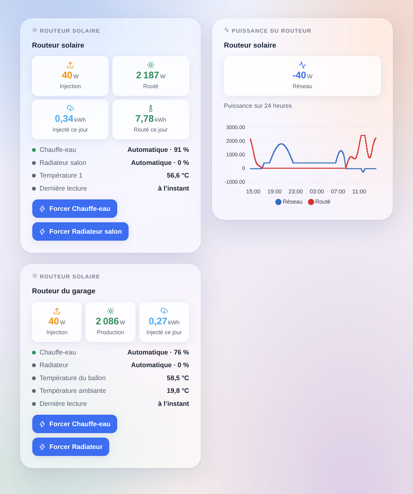

# Gladys Routeur solaire

[English](README.md) · **Français** · [Deutsch](README.de.md) · [Español](README.es.md)

[](LICENSE)
[](https://github.com/William-De71/gladys-solar-router/releases)
[](https://github.com/William-De71/gladys-solar-router/actions/workflows/release.yml)
[](https://gladysassistant.com)



Intégration externe [Gladys Assistant](https://gladysassistant.com) pour les routeurs solaires **F1ATB** et **MSunPV**, les boîtiers qui envoient le surplus de vos panneaux vers le chauffe-eau plutôt que sur le réseau. Elle affiche dans Gladys l’échange avec le réseau, la puissance routée ou produite et l’état de chaque charge, permet de forcer une charge en marche, à l’arrêt ou de la rendre à l’automatique depuis un interrupteur, un widget ou une scène, et déclenche des scènes quand un routeur ne répond plus ou qu’un forçage se termine — uniquement sur votre réseau local.

Documentation utilisateur : [English](docs/en.md) · [Français](docs/fr.md) · [Deutsch](docs/de.md) · [Español](docs/es.md).

Non affiliée à F1ATB ni à Ard-Tek. **Pas encore testée sur un vrai routeur** : les requêtes et les réponses suivent les sources du firmware F1ATB (V17) et, pour le MSunPV, les champs documentés par son intégration Home Assistant (aucun code repris de l’un ou de l’autre).

## Fonctionnalités

- Routeurs **F1ATB** (ESP32, firmware libre) et **MSunPV** (Ard-Tek, 2x2d et 4x4d) : adresses saisies dans la configuration, modèle reconnu à ses réponses ; un routeur est connu par son adresse MAC ou son numéro de série, une nouvelle adresse IP garde ses appareils.
- **Un appareil pour le routeur** : échange avec le réseau (catégorie `grid-sensor` de Gladys), énergie soutirée et injectée, puissance et énergie routées (F1ATB avec une seconde sonde), production solaire (MSunPV), températures, signal Wi-Fi.
- **Un appareil par sortie** : ouverture ou puissance, un interrupteur **Marche forcée** (F1ATB : pour une durée donnée, décomptée par le routeur ; MSunPV : jusqu’au retour en automatique), le mode, le forçage restant.
- **4 déclencheurs de scène** (ne répond plus, répond de nouveau, redémarré, fin du forçage), **2 actions de scène** (piloter une sortie, énergie du jour) et **2 widgets** (vue d’ensemble avec boutons, puissance sur 24 heures).
- Routeurs lus toutes les 5, 10, 30 ou 60 secondes, une requête à la fois.
- Local uniquement, sans compte ni cloud. Quatre langues partout : anglais, français, allemand, espagnol.

## Fonctionnement





De l’adresse à une commande :



### Transport

`transports: ["local"]` : l’intégration dialogue avec les routeurs en HTTP sur votre réseau ; **aucune donnée ne sort de chez vous**. Avec un seul canal, il n’y a ni bouton « Préférer la connexion locale » ni badge de transport par appareil. Aucun des deux routeurs ne s’annonce sur le réseau (pas de mDNS) : les adresses sont saisies. `/data/solar-router.json` (mode 0600) garde, par routeur, sa dernière adresse et son modèle, ses valeurs et ses sorties, les compteurs MSunPV cumulés en index, 24 heures de points à 5 minutes pour le graphique, et ce que savent les déclencheurs.

## Appareils et fonctionnalités

| Appareil       | Fonctionnalités (catégorie / type)                                                                                                                                                                                                                                                                                              |
| -------------- | ------------------------------------------------------------------------------------------------------------------------------------------------------------------------------------------------------------------------------------------------------------------------------------------------------------------------------- |
| Routeur F1ATB  | Soutirage et injection (`grid-sensor` / `input-power`, `output-power`, W), énergie soutirée et injectée (`grid-sensor` / `input-index`, `output-index`, kWh), puissance et énergie routées (`energy-sensor` / `power`, `index`), températures 1 à 4 (`temperature-sensor` / `decimal`, °C), signal Wi-Fi (`signal` / `integer`) |
| Routeur MSunPV | Échange avec le réseau (`grid-sensor` / `power`, W, signé), énergie soutirée et injectée (`grid-sensor` / `input-index`, `output-index`, cumulées depuis les compteurs journaliers), production (`energy-production-sensor` / `power`, `index`), températures du ballon, de la salle de bains et ambiante, signal Wi-Fi         |
| Sortie         | Ouverture (`switch` / `dimmer`, 0–100, lecture seule) ou puissance et énergie (MSunPV 4x4d, `energy-sensor`), Marche forcée (`switch` / `binary`, la seule commande), mode (`text` / `text`), forçage restant (`duration` / `integer`, min, F1ATB), heures pleine puissance du jour (`duration` / `decimal`, h, F1ATB)          |

- Les identifiants externes reposent sur l’identité du routeur : `ext:…:router:<id>` (les 12 chiffres hexadécimaux de l’adresse MAC du F1ATB, ou le numéro de série du MSunPV), `ext:…:output:<id>-a<n>` pour l’action n d’un F1ATB (0 est le triac), `ext:…:output:<id>-water_heater` et `-heater` pour un MSunPV.
- Le réseau suit la catégorie `grid-sensor` de Gladys telle que chaque routeur la donne : deux valeurs pour le F1ATB, une valeur signée pour le MSunPV (soutirage > 0, injection < 0).
- Le MSunPV ne donne que des compteurs journaliers : l’intégration les cumule en index, qui partent de 0 à la première lecture ; Gladys n’utilise que leurs augmentations.
- Une fonctionnalité apparaît dès que sa valeur a été vue (seconde sonde, sonde de température, Wi-Fi plutôt qu’Ethernet) : appuyez sur **Mettre à jour** dans l’écran Découverte.
- Les états sont envoyés quand ils changent, et toutes les 30 minutes sinon ; un routeur injoignable n’envoie rien (Gladys affiche ses valeurs comme anciennes).

## Déclencheurs, actions de scène et widgets



**Widgets** : Routeur solaire (un routeur, le premier par défaut : puissance soutirée ou injectée maintenant, puissance routée ou produite, énergie injectée et routée du jour, état de chaque sortie, deux températures, dernière lecture, et un bouton « Forcer … » / « Auto … » pour chacune des deux premières sorties) et Puissance du routeur (l’échange avec le réseau et la puissance routée ou produite sur les dernières 24 heures, un point toutes les 5 minutes).

**Déclencheurs** (un événement par changement, jamais à la première lecture, jamais à la suite d’une action ; filtre : le routeur ou la sortie) :

- **ne répond plus** : pas de réponse à 3 lectures de suite pendant au moins une minute ; variables : routeur, nom, modèle, adresse, lectures manquées, message ;
- **répond de nouveau** : variable : minutes sans réponse ;
- **redémarré** (F1ATB) : le temps de fonctionnement est reparti de zéro ; variable : heures de fonctionnement avant ;
- **fin du forçage** (F1ATB) : une sortie forcée en marche ou à l’arrêt est revenue d’elle-même en automatique ; variables : sortie, nom de la sortie, forçage terminé (`on` / `off`).

**Actions** :

- **piloter une sortie** : marche forcée, arrêt (arrêt forcé sur un F1ATB) ou automatique, avec une durée en minutes pour un F1ATB ; sorties : nom de la sortie, mode, minutes, `summary` ;
- **énergie du jour** : soutiré, injecté, routé et produit ce jour tel que le routeur le compte, l’échange réseau actuel (W, injection < 0) et un `summary`.

Les valeurs sont des fonctionnalités d’appareil : « injection supérieure à 1 000 W » ou « ballon sous 45 °C » sont des conditions d’appareil de Gladys, avec vos propres seuils.

Pas fait, volontairement : aucune modification des réglages du routeur (seuils, PID, priorités), pas de MQTT, pas d’import d’historique.

Exemples :

- Chaque nuit à 23 h, si la **Température du ballon** est sous 45 °C → **piloter une sortie** (chauffe-eau, marche forcée, 120 minutes).
- Quand **fin du forçage** → envoyer « {{triggerEvent.data.output_name}} : retour en automatique ».
- Chaque soir à 21 h → **énergie du jour** → envoyer son `summary`.

## Prérequis

- Gladys Assistant **5.3.0** ou plus récent (widgets et scènes des intégrations, catégorie `grid-sensor`, mots-clés du catalogue) : les instances plus anciennes ne peuvent pas installer l’intégration.
- Un routeur **F1ATB** (firmware V17 ou proche) ou **MSunPV** réglé avec sa propre interface web, sur le même réseau que Gladys.
- Son adresse IP (affichée sur l’écran du routeur ou dans votre box), idéalement fixée par un bail DHCP réservé.

### Le rythme de l’appareil

Les deux routeurs sont de petites cartes qui servent aussi leur propre page web et régulent la puissance plusieurs fois par seconde : le client envoie une requête à la fois, sans keep-alive, avec un délai de 10 secondes et une courte pause entre deux requêtes. Un tour F1ATB, c’est trois requêtes, un tour MSunPV une seule. Une commande relit aussitôt le routeur. Une adresse qui n’est pas un routeur est laissée de côté 30 minutes (ou jusqu’à **Rechercher et tester**).

## Installation

- **Depuis le store** : Intégrations → Solar Router (F1ATB, MSunPV) → Installer.
- **Depuis l’URL du dépôt** : Intégrations → intégration externe → `https://github.com/William-De71/gladys-solar-router`.
- **Mode développeur** : lancez `npm start` avec les variables données par Gladys (voir Développement).

## Configuration

| Champ ou bouton                   | Défaut      | Signification                                                                                            |
| --------------------------------- | ----------- | -------------------------------------------------------------------------------------------------------- |
| Adresses des routeurs             | —           | Adresses IP ou noms, séparés par des virgules, avec `:port` s’il n’est pas 80 ; obligatoire              |
| Lecture                           | 10 s        | 5 s, 10 s, 30 s ou 1 min                                                                                 |
| Durée du forçage (F1ATB)          | 60 min      | Durée pendant laquelle l’interrupteur Marche forcée et les boutons de widget forcent une sortie F1ATB    |
| Langue des textes                 | automatique | Noms des fonctionnalités, modes, textes des scènes et erreurs (automatique : langue du dernier widget)   |
| Rechercher et tester / Diagnostic | —           | Lit les routeurs et propose leurs appareils, indique l’adresse en échec ; écrit l’état dans les journaux |

## Utilisation

1. Réglez le routeur avec sa propre interface web (sorties, sondes) et notez son adresse IP.
2. Dans Gladys (Intégrations → Solar Router → Configuration) : saisissez l’adresse ; appuyez sur **Rechercher et tester**.
3. **Découverte**, puis ajoutez le routeur et les sorties voulues comme appareils.
4. Ajoutez les widgets à un tableau de bord, créez des scènes avec les fonctionnalités, les déclencheurs et les actions.

## Développement

```bash
npm install
npm test                       # node --test, faux routeurs F1ATB et MSunPV, jamais le réseau
npm run lint                   # ESLint
npm run format:check           # Prettier
npx github:GladysAssistant/integration-store . --skip-image-check
scripts/build-cover.sh         # cover.jpg depuis docs/assets/cover.svg
docs/illustrations/render.sh   # docs/assets/widgets.<lang>.png
```

En local, le SDK lit `GLADYS_HOST_API_URL`, `GLADYS_INTEGRATION_TOKEN` et `GLADYS_INTEGRATION_SELECTOR` (donnés par Gladys en mode développeur), et l’intégration lit `TZ`. `DEBUG=gladys-integration-sdk` affiche les journaux du SDK.

Les tests couvrent le client HTTP (une requête à la fois, les erreurs), les deux protocoles (les pages à caractères de contrôle du F1ATB, status.xml et les bits de commande du MSunPV), les instantanés et les index cumulés, les appareils (les champs qu’exige l’écran Découverte, les couples catégorie / type du cœur), les déclencheurs, les widgets (`validateWidgetContent`), le manifeste, les quatre langues, le script de release, et toute l’intégration face au faux Gladys du SDK et à de faux routeurs. `test/structure.test.js` fige toutes les clés stockées chez les utilisateurs.

## Processus de release


Chaque fusion sur `main` lance la CI, puis calcule la version d’après les [Conventional Commits](https://www.conventionalcommits.org/) depuis le dernier tag : `feat` → mineure, `fix` / `perf` → correctif, `!` ou `BREAKING CHANGE` → majeure (une mineure avant 1.0.0) ; `docs`, `chore`, `ci`, `test`, `style`, `refactor`, `build` seuls ne publient rien. La section du changelog est générée, le tag poussé, l’image multi-architecture construite, puis `main` reçoit le commit de release, la GitHub Release est créée et un dernier job vérifie l’image publique, le validateur du store et le topic.

- Le titre de la pull request devient le commit squash, puis la ligne du changelog : écrivez-le en anglais, pour l’utilisateur (`pr-title.yml` le vérifie). Ne modifiez jamais `CHANGELOG.md` à la main.
- 1.0.0 est une décision : Actions → Release → Run workflow avec `release-as: 1.0.0`. `dry-run` affiche la version et les notes sans rien publier.
- **Branche protégée** : des rulesets imposent une pull request sur `main` et verrouillent les tags `v*` ; seuls le mainteneur et les deploy keys passent. La release pousse avec la deploy key de l’environnement `release` (secret `RELEASE_DEPLOY_KEY`, `main` seulement) : un run lancé depuis une autre branche ne l’obtient jamais. `build.yml` et `github-release.yml` ne démarrent pas sur un tag : la release les appelle, ou lancez-les à la main (Actions → Run workflow, avec `version` pour l’image) pour terminer une release.
- Après la première release, rendez public le package `ghcr.io` (Package settings → Change visibility), sinon Gladys ne peut pas le télécharger.

## Dépannage

Voir [docs/fr.md](docs/fr.md#dépannage). Signalez un problème avec les versions de Gladys, de l’intégration et du firmware du routeur, le modèle du routeur, le message de **Rechercher et tester** et le résultat de **Diagnostic** (dans les journaux de l’intégration).

## Contribuer

Issues et pull requests bienvenues. Lancez `npm run format:check && npm run lint && npm test` avant d’ouvrir une pull request, et gardez inchangés tous les identifiants externes et les clés stockées (voir [CLAUDE.md](CLAUDE.md)). Des réponses capturées sur un vrai routeur (adresse MAC ou numéro de série modifiés) sont particulièrement bienvenues comme données de test.

## Sécurité

Voir [SECURITY.md](SECURITY.md) : signalez les vulnérabilités en privé. Les routeurs n’ont pas de mot de passe sur les pages utilisées ; n’importe qui sur votre réseau peut déjà les atteindre, gardez-les donc sur un réseau de confiance. `/data/solar-router.json` est écrit en mode 0600.

## Captures à venir

Les images ci-dessus sont des illustrations, pas des captures d’écran. Les vraies captures iront dans `docs/assets/screenshots/` (PNG, 1280 × 800) : `configuration.png`, `discovery.png` (un routeur et ses sorties proposés), `device.png` (une sortie avec son interrupteur Marche forcée), `scene-forcing.png` (une scène avec l’action « piloter une sortie »), `dashboard.png` (les deux widgets avec un vrai routeur).

## Licence

[Apache License 2.0](LICENSE) — voir aussi [NOTICE](NOTICE). F1ATB, MSunPV et Ard-Tek sont des noms de leurs propriétaires. Merci à la documentation et au SDK de Gladys, à F1ATB pour les sources publiées du routeur, et à l’intégration Home Assistant MSunPV pour la documentation de status.xml (lues pour les faits seulement, aucun code repris).
