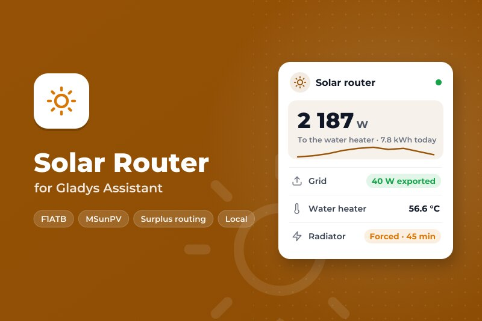
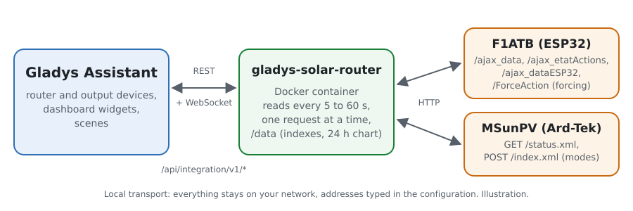
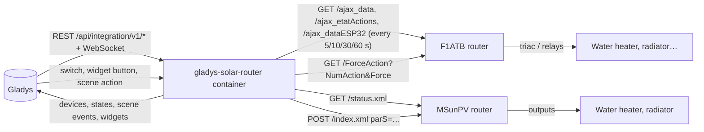
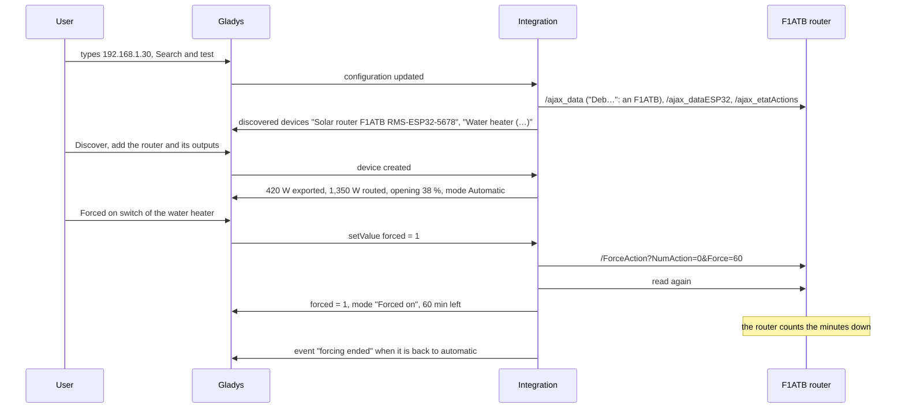
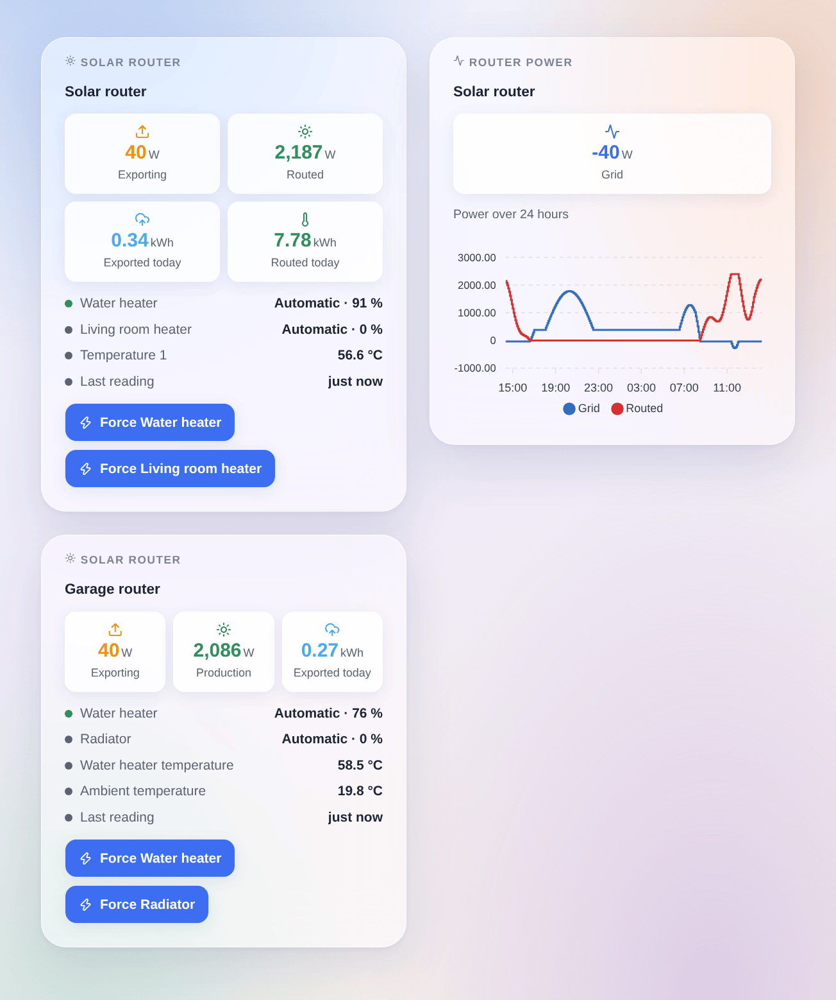

# Gladys Solar Router

**English** · [Français](README.fr.md) · [Deutsch](README.de.md) · [Español](README.es.md)

[](LICENSE)
[](https://github.com/William-De71/gladys-solar-router/releases)
[](https://github.com/William-De71/gladys-solar-router/actions/workflows/release.yml)
[](https://gladysassistant.com)



[Gladys Assistant](https://gladysassistant.com) external integration for the **F1ATB** and **MSunPV** solar routers, the boxes that send the surplus of your solar panels to the water heater instead of the grid. It shows the grid exchange, the routed or produced power and the state of each load in Gladys, lets you force a load on, off or back to automatic from a switch, a widget or a scene, and fires scenes when a router stops answering or a forcing ends — on your local network only.

User documentation: [English](docs/en.md) · [Français](docs/fr.md) · [Deutsch](docs/de.md) · [Español](docs/es.md).

Not affiliated with F1ATB nor with Ard-Tek. **Not tested with a real router yet**: the requests and answers follow the sources of the F1ATB firmware (V17) and, for the MSunPV, the fields documented by its Home Assistant integration (no code taken from either).

## Features

- **F1ATB** (ESP32, open firmware) and **MSunPV** (Ard-Tek, 2x2d and 4x4d) routers: addresses typed in the configuration, the model recognised by its answers; a router is known by its MAC address or serial number, so a new IP address keeps its devices.
- **One device for the router**: grid exchange (Gladys `grid-sensor` category), energy drawn and exported, routed power and energy (F1ATB with a second probe), solar production (MSunPV), temperatures, Wi-Fi signal.
- **One device per output**: opening or power, a **Forced on** switch (F1ATB: for a set duration, counted down by the router; MSunPV: until switched back), the mode, the forcing time left.
- **4 scene triggers** (not answering, answering again, restarted, forcing ended), **2 scene actions** (set an output, today’s energy) and **2 dashboard widgets** (overview with buttons, power over 24 hours).
- Routers read every 5, 10, 30 or 60 seconds, one request at a time.
- Local only, no account, no cloud. Four languages everywhere: English, French, German, Spanish.

## How it works





From the address to a command:



### Transport

`transports: ["local"]`: the integration talks to the routers over HTTP on your network; **no data leaves your home**. With a single channel, there is no "prefer local connection" button nor per-device transport badge. Neither router announces itself on the network (no mDNS): the addresses are typed. `/data/solar-router.json` (mode 0600) keeps, per router, its last address and model, its values and outputs, the MSunPV counters summed into indexes, 24 hours of 5-minute points for the chart, and what the triggers know.

## Devices and features

| Device        | Features (category / type)                                                                                                                                                                                                                                                                                                |
| ------------- | ------------------------------------------------------------------------------------------------------------------------------------------------------------------------------------------------------------------------------------------------------------------------------------------------------------------------- |
| F1ATB router  | Grid drawn and exported (`grid-sensor` / `input-power`, `output-power`, W), energy drawn and exported (`grid-sensor` / `input-index`, `output-index`, kWh), routed power and energy (`energy-sensor` / `power`, `index`), temperatures 1 to 4 (`temperature-sensor` / `decimal`, °C), Wi-Fi signal (`signal` / `integer`) |
| MSunPV router | Grid exchange (`grid-sensor` / `power`, W, signed), energy drawn and exported (`grid-sensor` / `input-index`, `output-index`, summed from the daily counters), production (`energy-production-sensor` / `power`, `index`), water heater, bathroom and ambient temperatures, Wi-Fi signal                                  |
| Output        | Opening (`switch` / `dimmer`, 0–100, read only) or power and energy (MSunPV 4x4d, `energy-sensor`), Forced on (`switch` / `binary`, the only command), mode (`text` / `text`), forcing time left (`duration` / `integer`, min, F1ATB), full-power hours today (`duration` / `decimal`, h, F1ATB)                          |

- External ids rest on the router identity: `ext:…:router:<id>` (the 12 hexadecimal digits of the F1ATB MAC address, or the MSunPV serial number), `ext:…:output:<id>-a<n>` for the action n of an F1ATB (0 is the triac), `ext:…:output:<id>-water_heater` and `-heater` for an MSunPV.
- The grid follows the Gladys `grid-sensor` category as each router reports it: two values for the F1ATB, one signed value for the MSunPV (import > 0, export < 0).
- The MSunPV only gives daily counters: the integration sums them into indexes, starting at 0 at the first reading; Gladys only uses their increases.
- A feature appears once its value was seen (a second probe, a temperature probe, Wi-Fi rather than Ethernet): press **Update** on the Discover screen.
- The states are sent when they change, and every 30 minutes otherwise; an unreachable router sends nothing (Gladys shows its values outdated).

## Scene triggers, actions and widgets



**Widgets**: Solar router (one router, the first one by default: drawn or exported power now, routed or produced power, energy exported and routed today, the state of each output, two temperatures, the last reading, and a "Force …" / "Auto …" button for each of the first two outputs) and Router power (the grid exchange and the routed or produced power over the last 24 hours, one point every 5 minutes).

**Triggers** (one event per transition, never at the first reading, never as the result of an action; filter: the router or the output):

- **not answering**: no answer to 3 readings in a row for at least a minute; variables: router, name, model, address, readings missed, message;
- **answers again**: variable: minutes without answer;
- **restarted** (F1ATB): the uptime went back; variable: hours running before;
- **forcing ended** (F1ATB): an output forced on or off went back to automatic by itself; variables: output, output name, the forcing that ended (`on` / `off`).

**Actions**:

- **set an output**: forced on, off (forced off on an F1ATB) or automatic, with a duration in minutes for an F1ATB; outputs: output name, mode, minutes, `summary`;
- **today’s energy**: drawn, exported, routed and produced today as the router counts them, the grid exchange now (W, export < 0) and a `summary`.

The values are device features: "exporting more than 1,000 W" or "water heater below 45 °C" are device conditions of Gladys, with your own thresholds.

Not done, on purpose: no change of the router settings (thresholds, PID, priorities), no MQTT, no history import.

Examples:

- Every night at 23:00, if the **Water heater temperature** is below 45 °C → **set an output** (water heater, forced on, 120 minutes).
- When **forcing ended** → send "{{triggerEvent.data.output_name}}: back to automatic".
- Every evening at 21:00 → **today’s energy** → send its `summary`.

## Requirements

- Gladys Assistant **5.3.0** or later (widgets and scenes of integrations, `grid-sensor` category, catalog keywords): older instances cannot install the integration.
- An **F1ATB** (firmware V17 or close) or **MSunPV** router set up with its own web interface, on the same network as Gladys.
- Its IP address (shown on the router screen or in your box), ideally fixed with a DHCP reservation.

### The pace of the device

Both routers are small boards that also serve their own web page and regulate the power several times a second: the client sends one request at a time, without keep-alive, with a 10-second timeout and a short pause between requests. An F1ATB round is three requests, an MSunPV round one. A command reads the router again at once. An address that is no router is left alone 30 minutes (or until **Search and test**).

## Installation

- **From the store**: Integrations → Solar Router (F1ATB, MSunPV) → Install.
- **From the repository URL**: Integrations → external integration → `https://github.com/William-De71/gladys-solar-router`.
- **Developer mode**: run `npm start` with the variables given by Gladys (see Development).

## Configuration

| Field or button              | Default   | Meaning                                                                                            |
| ---------------------------- | --------- | -------------------------------------------------------------------------------------------------- |
| Router addresses             | —         | IP addresses or names, separated by commas, with `:port` if it is not 80; required                 |
| Reading                      | 10 s      | 5 s, 10 s, 30 s or 1 min                                                                           |
| Forcing duration (F1ATB)     | 60 min    | How long the Forced on switch and the widget buttons force an F1ATB output (1 to 1440 minutes)     |
| Language of the texts        | automatic | Feature names, modes, scene texts and errors (automatic: the language of the last widget shown)    |
| Search and test / Diagnostic | —         | Reads the routers and offers their devices, says which address fails; writes the state in the logs |

## Usage

1. Set up the router with its own web interface (outputs, probes) and note its IP address.
2. In Gladys (Integrations → Solar Router → Configuration): type the address; press **Search and test**.
3. **Discover**, then add the router and the outputs you want as devices.
4. Add the widgets to a dashboard, build scenes with the features, the triggers and the actions.

## Development

```bash
npm install
npm test                       # node --test, fake F1ATB and MSunPV routers, never the network
npm run lint                   # ESLint
npm run format:check           # Prettier
npx github:GladysAssistant/integration-store . --skip-image-check
scripts/build-cover.sh         # cover.jpg from docs/assets/cover.svg
docs/illustrations/render.sh   # docs/assets/widgets.<lang>.png
```

Locally, the SDK reads `GLADYS_HOST_API_URL`, `GLADYS_INTEGRATION_TOKEN` and `GLADYS_INTEGRATION_SELECTOR` (given by Gladys in developer mode), and the integration reads `TZ`. `DEBUG=gladys-integration-sdk` shows the SDK logs.

The tests cover the HTTP client (one request at a time, the errors), both protocols (the control-character pages of the F1ATB, status.xml and the command bits of the MSunPV), the snapshots and the summed indexes, the devices (the fields the Discovery screen requires, the category / type pairs of the core), the triggers, the widgets (`validateWidgetContent`), the manifest, the four languages, the release script, and the whole integration against the fake Gladys of the SDK and fake routers. `test/structure.test.js` freezes every key users store.

## Release process


Every merge on `main` runs the CI, then computes the version from the [Conventional Commits](https://www.conventionalcommits.org/) since the last tag: `feat` → minor, `fix` / `perf` → patch, `!` or `BREAKING CHANGE` → major (a minor below 1.0.0); `docs`, `chore`, `ci`, `test`, `style`, `refactor`, `build` alone publish nothing. The changelog section is generated, the tag pushed, the multi-architecture image built, then `main` receives the release commit, the GitHub Release is created and a last job checks the public image, the store validator and the topic.

- The pull request title becomes the squash commit, then the changelog line: write it in English, for the user (`pr-title.yml` checks it). Never edit `CHANGELOG.md` by hand.
- 1.0.0 is a decision: Actions → Release → Run workflow with `release-as: 1.0.0`. `dry-run` shows the version and the notes without publishing.
- **Protected branch**: the release pushes its commit to `main` with `GITHUB_TOKEN`. The `protect-main` ruleset (no deletion, no force-push) lets it through; a stricter rule (pull request required, status checks) would need GitHub Actions in its bypass list, or a GitHub App.
- After the first release, make the `ghcr.io` package public (Package settings → Change visibility), or Gladys cannot pull it.

## Troubleshooting

See [docs/en.md](docs/en.md#troubleshooting). Report issues with the versions of Gladys, of the integration and of the router firmware, the model of the router, the message of **Search and test** and the result of **Diagnostic** (in the logs of the integration).

## Contributing

Issues and pull requests are welcome. Run `npm run format:check && npm run lint && npm test` before opening a pull request, and keep every external id and stored key unchanged (see [CLAUDE.md](CLAUDE.md)). Answers captured from a real router (with the MAC address or serial number changed) are especially welcome as test fixtures.

## Security

See [SECURITY.md](SECURITY.md): report vulnerabilities privately. The routers have no password on the pages used; anyone on your network can already reach them, so keep them on a trusted network. `/data/solar-router.json` is written with mode 0600.

## Screenshots to come

The images above are illustrations, not screenshots. Real screenshots will go in `docs/assets/screenshots/` (PNG, 1280 × 800): `configuration.png`, `discovery.png` (a router and its outputs offered), `device.png` (an output with its Forced on switch), `scene-forcing.png` (a scene with the "set an output" action), `dashboard.png` (the two widgets with a real router).

## License

[Apache License 2.0](LICENSE) — see also [NOTICE](NOTICE). F1ATB, MSunPV and Ard-Tek are names of their owners. Thanks to the Gladys documentation and SDK, to F1ATB for the published sources of the router, and to the Home Assistant MSunPV integration for documenting status.xml (read for the facts only, no code used).
