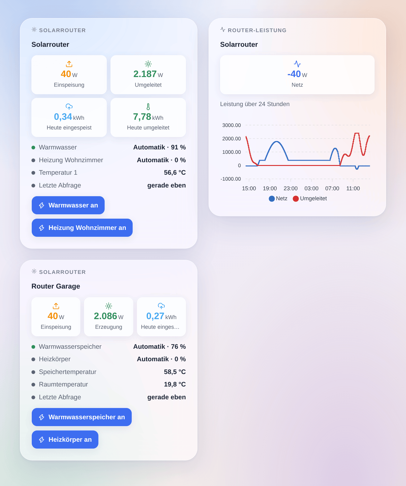

# Solarrouter (F1ATB, MSunPV)

## Überblick

Diese Integration bringt deinen **Solarrouter** in Gladys. Ein Solarrouter leitet den Überschuss deiner Solarmodule zu einem Verbraucher (meist dem Warmwasserspeicher, manchmal einem Heizkörper oder einer Pumpe), statt ihn ins Netz einzuspeisen. Zwei Router werden unterstützt:

- **F1ATB** (https://f1atb.fr), der offene Router auf einem ESP32 (Firmware V17), über die Seiten, die seine Weboberfläche liest: `/ajax_data`, `/ajax_etatActions`, `/ajax_dataESP32` und `/ForceAction`, um einen Ausgang zu erzwingen;
- **MSunPV** von Ard-Tek (Modelle 2x2d und 4x4d), über seine Seite `/status.xml` und `POST /index.xml`, um den Modus eines Ausgangs zu ändern.

Was du bekommst:

- Ein Gerät für den Router: Netzaustausch, bezogene und eingespeiste Energie, umgeleitete Leistung und Energie (F1ATB mit einer zweiten Sonde), Solarerzeugung (MSunPV), Temperaturen, WLAN-Signal.
- Ein Gerät pro Ausgang (jeder Verbraucher): Öffnung oder Leistung, ein Schalter **Zwangsbetrieb**, der Modus, die Restzeit des Zwangsbetriebs.
- Zwei Dashboard-Widgets, vier Szenen-Auslöser und zwei Szenen-Aktionen.

Transport: lokal. Die Integration spricht per HTTP in deinem Netzwerk mit dem Router; keine Daten gehen ins Internet. Sie ist weder mit F1ATB noch mit Ard-Tek verbunden. **Sie wurde noch nicht mit einem echten Router getestet**: Die Antworten folgen den Quellen der F1ATB-Firmware und, für den MSunPV, den Feldern, die seine Home-Assistant-Integration dokumentiert.

## Voraussetzungen

- Gladys Assistant 5.3.0 oder neuer.
- Ein F1ATB- oder MSunPV-Router im selben Netzwerk wie Gladys, bereits über seine eigene Weboberfläche eingerichtet (Ausgänge, Sonden).
- Seine IP-Adresse (auf dem Display des Routers oder in deinem Internet-Router zu sehen). Keiner der beiden meldet sich im Netzwerk an: Die Adresse muss eingegeben werden. Das Modell wird automatisch erkannt.
- Am besten eine feste IP-Adresse für den Router (eine DHCP-Reservierung in deinem Internet-Router). Ein Router mit neuer Adresse wird wiedergefunden, sobald du die neue eingibst: Er wird über seine MAC-Adresse (F1ATB) oder Seriennummer (MSunPV) erkannt, seine Geräte bleiben dieselben.

Die Integration liest jeden Router alle 5, 10, 30 oder 60 Sekunden, eine Anfrage nach der anderen: Diese kleinen Platinen liefern auch ihre eigene Webseite aus und regeln die Leistung mehrmals pro Sekunde.

## Konfiguration

| Feld                             | Bedeutung                                                                                                                                |
| -------------------------------- | ---------------------------------------------------------------------------------------------------------------------------------------- |
| Router-Adressen                  | IP-Adressen oder Namen deiner Router, durch Kommas getrennt (`192.168.1.30, 192.168.1.31:8080`); ein Port nach „:“, wenn es nicht 80 ist |
| Abfrage                          | Alle 5, 10 (Standard), 30 Sekunden oder jede Minute                                                                                      |
| Dauer des Zwangsbetriebs (F1ATB) | Minuten, die ein F1ATB-Ausgang über seinen Schalter oder eine Widget-Schaltfläche erzwungen bleibt (Standard 60, höchstens 1440)         |
| Sprache der Texte                | Namen der Funktionen, Modi, Szenentexte und Fehler; Automatisch folgt der Sprache des zuletzt angezeigten Widgets (en/fr/de/es)          |

Schaltflächen:

- **Suchen und testen** liest die Router unter den eingegebenen Adressen und bietet ihre Geräte im Bildschirm Entdecken an; es sagt dir, welche Adresse nicht antwortet oder kein Router ist.
- **Diagnose** schreibt, was die Integration weiß, in ihre Protokolle, für einen Fehlerbericht.

## Verwendung

### Geräte

Öffne nach der Konfiguration **Entdecken**: Der Router und jeder seiner Ausgänge werden angeboten („Solarrouter F1ATB RMS-ESP32-5678“, „Chauffe-eau (F1ATB RMS-ESP32-5678)“). Füge hinzu, was du möchtest, stelle jeden Ausgang in seinen Raum und benenne ihn bei Bedarf um: Die Widgets und Szenen verwenden den Namen, den du ihm gibst.

| Gerät                  | Funktionen                                                                                                                                                                                                                                                                     |
| ---------------------- | ------------------------------------------------------------------------------------------------------------------------------------------------------------------------------------------------------------------------------------------------------------------------------ |
| F1ATB-Router           | Bezug aus dem Netz und Einspeisung ins Netz (zwei Werte, Kategorie Netz), bezogene und eingespeiste Energie (Zähler des Routers, kWh), umgeleitete Leistung und Energie (mit einer zweiten Sonde am Verbraucher), bis zu 4 Temperaturen, WLAN-Signal (nicht bei Ethernet)      |
| F1ATB-Ausgang (Aktion) | Öffnung (0 bis 100 %; ein Relais ist 0 oder 100), Schalter **Zwangsbetrieb**, Modus (Automatik, Zwangsbetrieb, Zwangsabschaltung), Restzeit Zwangsbetrieb (Minuten), Volllaststunden heute                                                                                     |
| MSunPV-Router          | Netzaustausch (ein Wert mit Vorzeichen: Bezug > 0, Einspeisung < 0), bezogene und eingespeiste Energie (von der Integration aus den Tageszählern aufsummiert, ab 0), Solarerzeugung und erzeugte Energie, Speicher-, Bad- und Raumtemperatur (wenn angeschlossen), WLAN-Signal |
| MSunPV-Ausgang         | Warmwasserspeicher und Heizkörper: Öffnung in % (2x2d) oder Leistung in W und ihre Energie (4x4d), Schalter **Zwangsbetrieb**, Modus (Automatik, Zwangsbetrieb, Aus)                                                                                                           |

- Eine Funktion erscheint, sobald der Router ihren Wert geliefert hat (zweite Sonde, Temperatursonde): Drücke **Aktualisieren** im Bildschirm Entdecken, um sie einem bereits erstellten Gerät hinzuzufügen.
- Der Schalter **Zwangsbetrieb**: Beim F1ATB wird der Ausgang für die Dauer aus der Konfiguration erzwungen, der Router zählt sie selbst herunter und kehrt dann zur Automatik zurück; beim MSunPV bleibt der Ausgang erzwungen, bis du ihn ausschaltest (zurück zur Automatik).
- Die anderen Funktionen sind nur lesbar. Die Werte werden bei jeder Änderung gesendet, sonst alle 30 Minuten; ein Router, der nicht antwortet, sendet nichts (Gladys zeigt seine Werte als veraltet).

### Dashboard-Widgets

- **Solarrouter**: ein Router (standardmäßig der erste): der aktuelle Bezug oder die Einspeisung, die umgeleitete (F1ATB) oder erzeugte (MSunPV) Leistung, die heute eingespeiste und umgeleitete Energie, der Zustand jedes Ausgangs, zwei Temperaturen, die letzte Abfrage und eine Schaltfläche für jeden der ersten zwei Ausgänge („… an“ / „… Auto“).
- **Router-Leistung**: der Netzaustausch und die umgeleitete oder erzeugte Leistung der letzten 24 Stunden (ein Punkt alle 5 Minuten, von der Integration gespeichert).

### Szenen

Auslöser (ein Ereignis pro Wechsel, nie bei der ersten Abfrage, nie als Folge einer Aktion):

- **Solarrouter: antwortet nicht**: keine Antwort auf 3 Abfragen in Folge und mindestens eine Minute lang;
- **Solarrouter: antwortet wieder**, mit den Minuten ohne Antwort;
- **Solarrouter: neu gestartet** (F1ATB): seine Laufzeit begann von vorn;
- **Solarrouter: Zwangsbetrieb beendet** (F1ATB): ein erzwungener Ausgang ist am Ende seiner Dauer von selbst zur Automatik zurückgekehrt.

Aktionen:

- **Solarrouter: Ausgang steuern**: Zwangsbetrieb, Aus (Zwangsabschaltung beim F1ATB) oder Automatik; eine Dauer in Minuten für einen F1ATB;
- **Solarrouter: Energie heute**: heute bezogen, eingespeist, umgeleitet und erzeugt (so, wie der Router zählt), der aktuelle Netzaustausch und ein Satz (`summary`).

Die Werte sind Gerätefunktionen: „Einspeisung über 1.000 W“ oder „Speicher unter 45 °C“ sind Gerätebedingungen von Gladys, mit deinen eigenen Schwellen.

Beispiele:

- Jede Nacht um 23 Uhr, wenn die **Speichertemperatur** unter 45 °C liegt → **Solarrouter: Ausgang steuern** (Warmwasserspeicher, Zwangsbetrieb, 120 Minuten): warmes Wasser am Morgen, im Niedertarif, nach einem bewölkten Tag.
- Wenn **Solarrouter: Zwangsbetrieb beendet** → „{{triggerEvent.data.output_name}}: zurück auf Automatik“ senden.
- Jeden Abend um 21 Uhr → **Solarrouter: Energie heute** → seine `summary` senden.

## Fehlerbehebung

- **„Keine Antwort von …“**: Prüfe die Adresse (öffne sie in einem Browser: Die Webseite des Routers muss erscheinen), den Port, wenn es nicht 80 ist, und ob der Router im selben Netzwerk wie Gladys ist.
- **„… antwortet, ist aber weder ein F1ATB- noch ein MSunPV-Router“**: Die Adresse gehört zu einem anderen Gerät. Ein F1ATB beantwortet `/ajax_data` mit einem Text, der mit „Deb“ beginnt; ein MSunPV beantwortet `/status.xml`. Eine solche Adresse wird nach 30 Minuten erneut versucht, oder sofort mit **Suchen und testen**.
- **Kein WLAN-Signal**: Ein Router am Ethernet hat keins, das ist normal.
- **Eine MSunPV-Temperatur fehlt**: Eine Sonde, die 0 anzeigt, wird erst angeboten, wenn sie etwas misst.
- **Die MSunPV-Zähler beginnen bei 0**: Der Router liefert nur Tageszähler; die Integration summiert sie ab der ersten Abfrage auf. Gladys verwendet nur ihre Zuwächse.
- **Ein F1ATB-Ausgang reagiert nicht**: Im F1ATB muss der Ausgang aktiv sein, und der Triac (Ausgang 0) existiert nur, wenn der Router auf das Netz synchronisiert ist.
- Für einen Fehlerbericht: Drücke **Diagnose**, kopiere dann die Protokolle der Integration (mit `DEBUG=gladys-integration-sdk` für die Details des SDK) und nenne die Versionen von Gladys, der Integration und der Router-Firmware.
