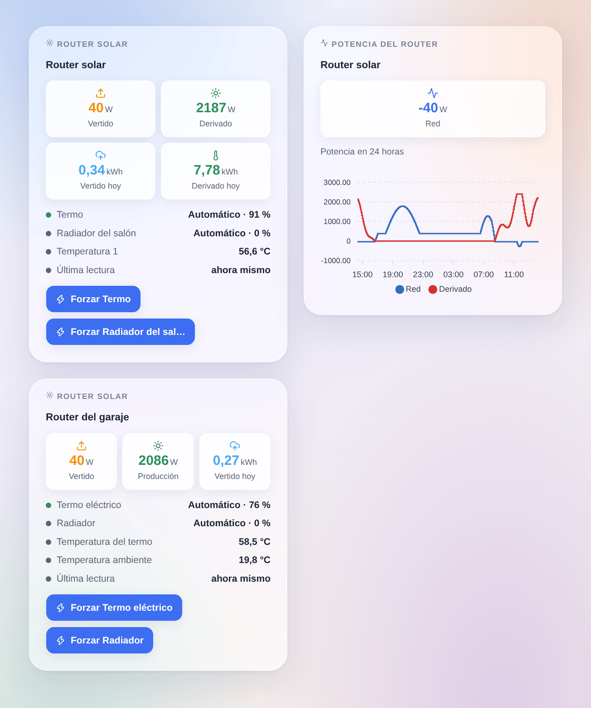

# Router solar (F1ATB, MSunPV)

## Presentación

Esta integración lleva su **router solar** a Gladys. Un router solar envía el excedente de sus paneles a una carga (normalmente el termo eléctrico, a veces un radiador o una bomba) en lugar de verterlo a la red. Se admiten dos routers:

- **F1ATB** (https://f1atb.fr), el router abierto sobre un ESP32 (firmware V17), mediante las páginas que lee su interfaz web: `/ajax_data`, `/ajax_etatActions`, `/ajax_dataESP32`, y `/ForceAction` para forzar una salida;
- **MSunPV** de Ard-Tek (modelos 2x2d y 4x4d), mediante su página `/status.xml`, y `POST /index.xml` para cambiar el modo de una salida.

Lo que obtiene:

- Un dispositivo para el router: intercambio con la red, energía consumida y vertida, potencia y energía derivadas (F1ATB con una segunda sonda), producción solar (MSunPV), temperaturas, señal Wi-Fi.
- Un dispositivo por salida (cada carga): apertura o potencia, un interruptor **Marcha forzada**, el modo, el tiempo de forzado restante.
- Dos widgets de panel, cuatro disparadores y dos acciones de escena.

Transporte: local. La integración se comunica con el router por HTTP en su red; ningún dato sale a internet. No está afiliada a F1ATB ni a Ard-Tek. **Todavía no se ha probado con un router real**: las respuestas siguen las fuentes del firmware F1ATB y, para el MSunPV, los campos documentados por su integración de Home Assistant.

## Requisitos

- Gladys Assistant 5.3.0 o posterior.
- Un router F1ATB o MSunPV en la misma red que Gladys, ya configurado con su propia interfaz web (salidas, sondas).
- Su dirección IP (en la pantalla del router o en su router de internet). Ninguno de los dos se anuncia en la red: hay que introducir la dirección. El modelo se reconoce solo.
- Idealmente, una dirección IP fija para el router (una reserva DHCP en su router de internet). Un router que cambia de dirección se vuelve a encontrar en cuanto introduce la nueva: se le conoce por su dirección MAC (F1ATB) o su número de serie (MSunPV), sus dispositivos siguen siendo los mismos.

La integración lee cada router cada 5, 10, 30 o 60 segundos, una petición a la vez: estas pequeñas placas también sirven su propia página web y regulan la potencia varias veces por segundo.

## Configuración

| Campo                        | Significado                                                                                                                         |
| ---------------------------- | ----------------------------------------------------------------------------------------------------------------------------------- |
| Direcciones de los routers   | Direcciones IP o nombres de sus routers, separados por comas (`192.168.1.30, 192.168.1.31:8080`); un puerto tras «:» si no es el 80 |
| Lectura                      | Cada 5, 10 (por defecto), 30 segundos o cada minuto                                                                                 |
| Duración del forzado (F1ATB) | Minutos que una salida F1ATB permanece forzada con su interruptor o un botón del widget (60 por defecto, 1440 como máximo)          |
| Idioma de los textos         | Nombres de las funciones, modos, textos de escenas y errores; automático sigue el idioma del último widget mostrado (en/fr/de/es)   |

Botones:

- **Buscar y probar** lee los routers en las direcciones introducidas y ofrece sus dispositivos en la pantalla Descubrir; indica qué dirección no responde o no es un router.
- **Diagnóstico** escribe lo que sabe la integración en sus registros, para un informe de error.

## Uso

### Dispositivos

Tras la configuración, abra **Descubrir**: se ofrecen el router y cada una de sus salidas («Router solar F1ATB RMS-ESP32-5678», «Chauffe-eau (F1ATB RMS-ESP32-5678)»). Añada lo que desee, coloque cada salida en su habitación y cámbiele el nombre si lo desea: los widgets y las escenas usan el nombre que usted le da.

| Dispositivo           | Funciones                                                                                                                                                                                                                                                                                         |
| --------------------- | ------------------------------------------------------------------------------------------------------------------------------------------------------------------------------------------------------------------------------------------------------------------------------------------------- |
| Router F1ATB          | Potencia consumida de la red y potencia vertida a la red (dos valores, categoría red), energía consumida y vertida (contadores del router, kWh), potencia y energía derivadas (con una segunda sonda en la carga), hasta 4 temperaturas, señal Wi-Fi (no en Ethernet)                             |
| Salida F1ATB (acción) | Apertura (0 a 100 %; un relé vale 0 o 100), interruptor **Marcha forzada**, modo (Automático, Marcha forzada, Parada forzada), tiempo de forzado restante (minutos), horas a plena potencia hoy                                                                                                   |
| Router MSunPV         | Intercambio con la red (un valor con signo: consumo > 0, vertido < 0), energía consumida y vertida (sumadas por la integración a partir de los contadores diarios, desde 0), producción solar y energía producida, temperaturas del termo, del baño y ambiente (si están conectadas), señal Wi-Fi |
| Salida MSunPV         | Termo y radiador: apertura en % (2x2d) o potencia en W y su energía (4x4d), interruptor **Marcha forzada**, modo (Automático, Marcha forzada, Apagado)                                                                                                                                            |

- Una función aparece en cuanto el router ha dado su valor (segunda sonda, sonda de temperatura): pulse **Actualizar** en la pantalla Descubrir para añadirla a un dispositivo ya creado.
- El interruptor **Marcha forzada**: en un F1ATB, la salida se fuerza durante la duración de la configuración y el router la descuenta solo, y luego vuelve a automático; en un MSunPV, la salida permanece forzada hasta que la apague (vuelta a automático).
- Las demás funciones son de solo lectura. Los valores se envían cuando cambian y, si no, cada 30 minutos; un router que no responde no envía nada (Gladys muestra sus valores como antiguos).

### Widgets del panel

- **Router solar**: un router (el primero por defecto): la potencia consumida o vertida ahora, la potencia derivada (F1ATB) o producida (MSunPV), la energía vertida y derivada hoy, el estado de cada salida, dos temperaturas, la última lectura y un botón para cada una de las dos primeras salidas («Forzar …» / «Auto …»).
- **Potencia del router**: el intercambio con la red y la potencia derivada o producida en las últimas 24 horas (un punto cada 5 minutos, guardado por la integración).

### Escenas

Disparadores (un evento por cambio, nunca en la primera lectura, nunca como resultado de una acción):

- **Router solar: no responde**: sin respuesta a 3 lecturas seguidas durante al menos un minuto;
- **Router solar: vuelve a responder**, con los minutos sin respuesta;
- **Router solar: reiniciado** (F1ATB): su tiempo de funcionamiento volvió a cero;
- **Router solar: fin del forzado** (F1ATB): una salida forzada en marcha o parada ha vuelto sola a automático al terminar su duración.

Acciones:

- **Router solar: controlar una salida**: marcha forzada, parada (parada forzada en un F1ATB) o automático; una duración en minutos para un F1ATB;
- **Router solar: energía del día**: consumida, vertida, derivada y producida hoy (tal como la cuenta el router), el intercambio actual con la red y una frase (`summary`).

Los valores son funciones de dispositivo: «vertido superior a 1.000 W» o «termo por debajo de 45 °C» son condiciones de dispositivo de Gladys, con sus propios umbrales.

Ejemplos:

- Cada noche a las 23:00, si la **Temperatura del termo** está por debajo de 45 °C → **Router solar: controlar una salida** (termo, marcha forzada, 120 minutos): agua caliente por la mañana, en horas valle, tras un día nublado.
- Cuando **Router solar: fin del forzado** → enviar «{{triggerEvent.data.output_name}}: vuelta a automático».
- Cada tarde a las 21:00 → **Router solar: energía del día** → enviar su `summary`.

## Solución de problemas

- **«Sin respuesta de …»**: compruebe la dirección (ábrala en un navegador: debe aparecer la página web del router), el puerto si no es el 80, y que el router esté en la misma red que Gladys.
- **«… responde, pero no es un router F1ATB ni MSunPV»**: la dirección pertenece a otro aparato. Un F1ATB responde a `/ajax_data` con un texto que empieza por «Deb»; un MSunPV responde a `/status.xml`. Esa dirección se vuelve a probar a los 30 minutos, o enseguida con **Buscar y probar**.
- **Sin señal Wi-Fi**: un router por Ethernet no tiene, es normal.
- **Falta una temperatura del MSunPV**: una sonda que lee 0 no se ofrece hasta que mide algo.
- **Los contadores del MSunPV empiezan en 0**: el router solo da contadores diarios; la integración los suma desde la primera lectura. Gladys solo usa sus aumentos.
- **Una salida F1ATB no cambia**: en el F1ATB, la salida debe estar activa, y el triac (salida 0) solo existe si el router está sincronizado con la red eléctrica.
- Para un informe de error: pulse **Diagnóstico**, copie los registros de la integración (con `DEBUG=gladys-integration-sdk` para el detalle del SDK) e indique las versiones de Gladys, de la integración y del firmware del router.
